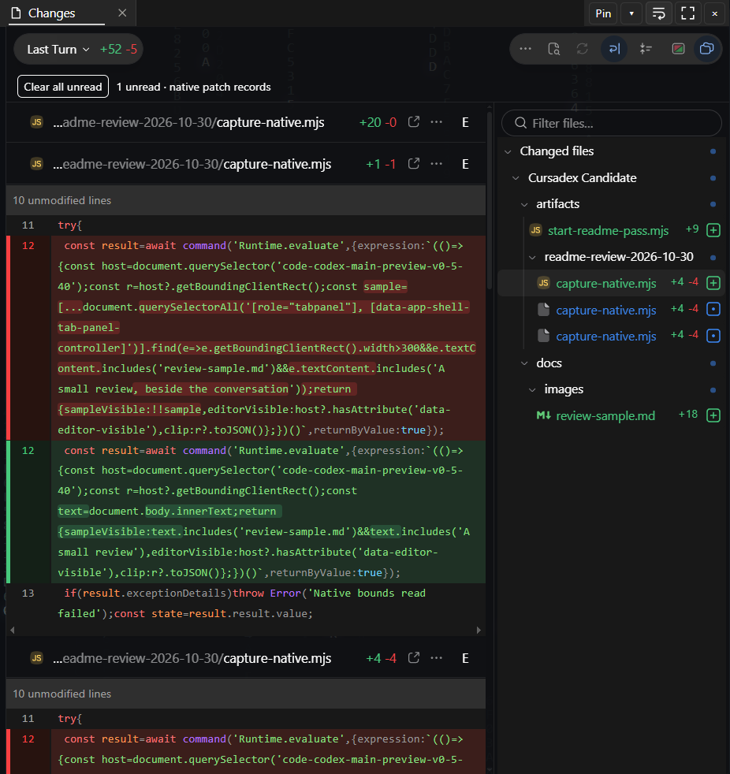

# OpsWolf

OpsWolf adds a file explorer, an editor and a place to review changes beside your Codex chat. Keep the conversation going while you read, edit and check the actual files.

Built on [Code-Codex](https://github.com/Rice-dog/code-codex), maintained independently. This is an unofficial community project, with no affiliation to OpenAI.

## From a human to a human

I wanted a file tree on the left, chat in the middle, and somewhere on the right where I could actually work on files. Then came tabs, pins, word wrap, citations and a better way to see what the agent had changed.

So yeah, that escalated pretty quickly lol.

**This is still an alpha, so expect a few rough edges.** There's no setup wizard yet. You'll need Windows and the official Codex desktop app. We have a ZIP you can unpack and run without installing coding tools, but we're still testing it before putting out a public release. Testing it on another PC is next.

We're on **OpsWolf 0.1.0-alpha.18**, built on [Code-Codex v0.6.0](releases/README.md). Rain now lets you save your own presets, choose two looks to blend between, and keep those choices for next time. The new controls and saved blend choices have worked on my setup, including after a restart. The editor also has **Refresh**, **Clear list** and **Show all**. [More about Rain's settings](docs/editor/code-rain-integration.md#presets-and-blend-settings).

### Read it, then work on it

Open a file from the explorer and it appears beside chat. **Preview** is for reading; **Edit** lets you change supported text files. **Save**, or **Ctrl+S**, writes the file. Markdown Preview can show headings, links and tables; Edit shows the source that makes them.


*Preview: a sample Markdown file in the real editor. The chat beside it is a demo.*


*Edit: the same file as source text, with word wrap and line numbers.*

The **E** button opens or hides the editor. Drag its left edge to resize it, or use its fullscreen button when you want more room. Hiding a fullscreen editor resets it, so the next E puts it beside chat again.

Tabs can scroll with your mouse wheel, move by dragging, and appear in an open-files dropdown. Pin files to reopen them for that project. **Close all** leaves pins alone, and unsaved edits get a save/discard/cancel choice. Pins remember files, not unsaved drafts.

### See what changed without losing the conversation

Click Codex's live **files changed** bubble and its comparison viewer opens in the editor's **Changes** tab. You keep Codex's review controls, with the comparison beside your chat. Clicking a file in the bubble's hover list takes you to that file's change.

List getting long? **Clear list** tucks those entries away for this session. New recorded edits bring files back, and **Show all** brings the cleared entries back whenever you want. It doesn't undo your work. **Clear all unread** just clears the unread dots.



*Codex's Changes viewer inside our editor, captured in alpha.3. This shows changes to our public screenshot tool.*

There's also a persistent **Native changes** panel above the message box. It stays available after the live bubble has gone. Expand the file list, then open just the changes you want to read. **Open file** takes you from the recorded diff to the current file, where you can edit it.


*The panel above chat, with a sample change open on the right. The conversation is a demo. This is a second way to review changes, separate from the Changes tab above.*

This shows changes Codex has recorded, even for project files that aren't in Git. It can miss edits made by hand or through commands, so keep your own backups too.

### The other little things that help

- **Point at the actual lines.** Select text and right-click to cite it in chat, copy a citation, or collect several ranges. Clicking a reference opens and highlights its source. It works across supported text formats.
- **Keep your reading position.** Scroll up to read without the feed constantly pulling you away. Sending your next message resumes following the conversation.
- **Find the right file.** File links in chat open in the editor when they're inside the current project. Dragging a file from the explorer into chat supplies its full location.
- **Make it comfortable.** Settings include source wrap, a minimap, an optional typing-speed counter and first-chat sidebar collapse. Our menu/settings name and logo can use your own saved identity profile; Windows identity aisn't changed by that (yet).
- **Add some atmosphere.** Optional preview plugins and backgrounds live in Preview Market. [Code Rain](https://github.com/ThornsOfire/OpsWolf-Code-Rain) adds configurable rain; [Nova Fox](https://github.com/ThornsOfire/nova-fox-companion) is a separate companion with optional OpsWolf integration.

Open **OpsWolf → OpsWolf settings…** for our preferences. Open **OpsWolf → Preview Market** to add or enable preview plugins and backgrounds. With Rain active, the background-settings button at the top of the explorer opens its controls directly. If you've chosen your own app label, look under that menu name instead.


*Our settings panel using a demo profile. Yours can have its own name and artwork. [About these screenshots](docs/images/README.md).*

### A few rough edges, because alpha means alpha

- Big files have limits: you can read up to **10 MiB**, but editing stops at **512 KiB**. Large Markdown files open as plain text first; you can choose to load the formatted view. If a file can't be edited, a red message explains why.
- Citations work, but you might still see a huge ugly link while typing or hovering over one. Making those look tidy is still on the list.
- The agent's activity details are meant to open automatically so you can see what it's doing. We've made a fix, but still need to check the screen where it was failing. This is separate from following new messages or scrolling up to read.
- Rain is much smoother on my setup now, even while blending between looks. Saved blend choices also survived a restart. The personal preset library needs more testing, and we'd love feedback from other PCs. The editor's transparency still doesn't work with every theme.
- This is a basic text and code editor for now. Code suggestions, debugging tools, a reliable AI context meter and support for more file types are still on the wishlist.
- Updates can break things we rely on. **Review updates** tells you when a new Code-Codex version is available, and we stop its installer from replacing OpsWolf. Codex itself can still update through Windows or the Store. To restart OpsWolf, save your work, close it normally and use your OpsWolf launcher again. The built-in Restart button is blocked because it can reopen without our additions. [How updates work](docs/editor/manual-updates.md).

The [user guide](docs/editor/README.md) has more help, and [known issues](docs/editor/known-issues.md) covers the bugs we're tracking. We haven't tested every Codex version, theme or monitor setup yet.

<a id="getting-it-running"></a>

### Getting started today

The test download is on GitHub under **Actions**. You'll need to sign in to download it. There isn't a public alpha Release yet, and these test downloads expire. The [download and launch guide](docs/editor/portable.md) walks you through it.

1. Download the test package and unpack the outer ZIP. There's an OpsWolf ZIP inside; unpack that one too.
2. Save your work and close Codex normally.
3. Open the extracted OpsWolf folder and double-click **Launch OpsWolf.cmd**.

Use that launcher whenever you want OpsWolf. Your usual Codex shortcut still opens regular Codex. The folder doesn't need a special name or a copy of my workspace. Older Code-Codex installers aren't installers for these additions.

### What you actually need

- **Windows on an Intel or AMD PC, plus the [official Codex desktop app](https://learn.chatgpt.com/docs/app).** OpsWolf runs alongside it, so get Codex installed and signed in first.
- **The OpsWolf test package.** It contains our built app files. You don't need Git, Rust or Node just to run it. If you want to build your own copy, give your coding agent the [setup section below](#build-and-launch); it lists the tools and commands.
- **Whatever extras you like.** Open **OpsWolf → Preview Market** to enable previews for things like Markdown and PDF, or a background such as Code Rain. [Nova Fox](https://github.com/ThornsOfire/nova-fox-companion) is a separate, optional companion. You don't need all of them, and being able to preview a file doesn't always mean you can edit it.

Building your own copy can mean downloading extra tools and libraries. Have your agent explain what it needs before it starts installing things.

### Optional: let an agent work with Windows

Want your agent to help test a window or click through something with you? We use [TaskKit](https://github.com/Longtran2404/taskkit-windows-computer-mcp) for that. It lets the agent see screenshots and use the mouse and keyboard in apps you allow. You don't need it to use OpsWolf.

Give your agent the [TaskKit setup guide](https://github.com/Longtran2404/taskkit-windows-computer-mcp/blob/main/docs/WINDOWS10_QUICKSTART.md) if you'd like to try it. Start with one app and tell the agent what it's allowed to do. Screenshots are sent to the AI service you're using, so keep anything private out of view. You can press **Escape** or **F12** yourself to stop TaskKit's control.

<a id="credit-and-contributing"></a>

### Credit, bugs and helping out

Big credit to [Rice-dog and the Code-Codex contributors](https://github.com/Rice-dog/code-codex). They built the launcher, workspace bridge, explorer and plugin foundation that made this possible.

If something breaks in our additions, report it to this fork with your versions, what you clicked, what happened and what you expected. A small sample helps a ton. Keep private documents, keys and chats out of public reports.

[Changelog](CHANGELOG.md) · [Contributing](CONTRIBUTING.md) · [MIT license](LICENSE) · [Third-party notices](THIRD_PARTY_NOTICES_EN.md)

## For agents, from an agent

<details>
<summary>Source, setup, interfaces and validation</summary>

### Identity and scope

| Item | Contract |
| --- | --- |
| Implementation | `candidate/planned-development`; [source branch](https://github.com/ThornsOfire/OpsWolf/tree/candidate/planned-development). `main` is a documentation landing page; `feature/right-editor-pane` is the historical baseline. |
| Versions | See [fork metadata](cursadex-version.json) for the display version and [Cargo.toml](Cargo.toml) for the inherited package version. This integration targets upstream Code-Codex v0.6.0. [Rain has its own plugin version](releases/plugins/appearance/code-rain/manifest.json). The source revision, package version, local handoff and running build each have their own identity. |
| Qualification | Alpha.18: 62 combined local gates; native tests 499 passed / 24 inherited ignores / 0 failed. Local owner observations confirm menu controls and saved blend choices after restart. Portable revision 1: 14 builder + 5 runtime-auditor fixtures, relocated CLI/hash/plugin checks; 25 included plugins, 4 redistribution exclusions. Hosted results belong to their exact Actions run; first-recipient/clean-machine acceptance is pending. [Portable scope and checklist](docs/editor/portable.md); [earlier integration evidence](docs/editor/upstream-integration.md#alpha15-qualification). |
| Legacy naming | Formerly Cursadex. Preserve `cursadex-*` metadata, event/storage keys, CSS hooks and technical launch names. Branding changes do not authorize migrations or identifier refactors. |
| Portability | No maintainer Desktop layout, app-state paths, personal identity artwork or external workspace scripts required by a clone. No public installer/fresh-machine certification yet. |

### Build and launch

These setup requirements come from the source manifests, scripts and upstream guidance. Local build checks and bounded owner observations are recorded separately; a fresh-machine install and broader native-host acceptance remain unverified.

| Use | Dependencies / source of truth |
| --- | --- |
| Run | Windows x64 (inherited launcher baseline Windows 10 build 19041+), separately installed official Codex host, matching built companion/UI. Build tools and MCP servers are not general runtime requirements. |
| Build UI | [Git for Windows](https://git-scm.com/install/windows) and a supported [Node LTS with npm](https://nodejs.org/en/download) satisfying [`engines.node >=20.19`](packages/explorer-ui/package.json). The minimum is not a recommendation to install EOL Node 20; check the [official release status](https://nodejs.org/en/about/previous-releases). |
| Build native | Upstream documents Windows 11 x64 for source builds. Use [Rust through rustup](https://rust-lang.org/tools/install/) with the Windows MSVC toolchain and [Visual Studio Desktop C++ Build Tools/Windows SDK](https://learn.microsoft.com/en-us/cpp/build/vscpp-step-0-installation). [`Cargo.toml`](Cargo.toml) declares Rust 1.85 minimum; resolve the locked dependencies with a compatible installed stable toolchain. |
| Package MSI only | [WiX](https://docs.firegiant.com/wix/using-wix/) and [.NET SDK](https://dotnet.microsoft.com/en-us/download) for the documented .NET-tool route; a separately supplied WiX distribution still needs its own prerequisites checked. [`build-msi.ps1`](scripts/build-msi.ps1) pins WiX 5.0.2 and restores it with `dotnet tool install` only if `-WixPath` is omitted and its cached tool is missing. MSI's three-number version rule is separate from the alpha display version. Neither tool is needed for ordinary editor use or the UI/native build. |
| Selected browser fixtures only | Installed Chrome at the path used by [`browser-fixture.mjs`](scripts/browser-fixture.mjs). Chrome is not an additional normal OpsWolf runtime requirement. |
| Optional desktop automation | Prefer independent TaskKit; Python 3.11+, Tkinter, Windows `py` launcher, MCP registration per its [quickstart](https://github.com/Longtran2404/taskkit-windows-computer-mcp/blob/main/docs/WINDOWS10_QUICKSTART.md). Codex CLI registration is optional, not an OpsWolf prerequisite. Computer Use is a fallback when available. Neither is required by OpsWolf. Reviewed TaskKit source: 0.5.1, matching an earlier `bridge_status` version report; exact source/running-server hash identity unverified. |
| Optional features | Preview/background packages follow the pinned catalog/cache and explicit Preview Market actions. Nova Fox has its own standalone prerequisites; neither Nova nor a personal MCP stack is required by OpsWolf. |

Install/download prerequisites only with environment authorization. [`build.ps1`](scripts/build.ps1) calls `npm ci` and `cargo build --workspace --locked`, **not** Cargo's `--offline` mode; inspect cache/dependency needs before execution. A reviewed runtime build and a new dependency installation are separate decisions.

```powershell
git clone --branch candidate/planned-development https://github.com/ThornsOfire/OpsWolf.git
Set-Location OpsWolf
.\scripts\build.ps1 -Configuration Release
```

`build.ps1`: installer/protocol generation and checks → `npm ci` + UI build → locked Cargo workspace build → local installer payload assembly. Native outputs: `target/release/`; bundle: `packages/explorer-ui/dist/explorer.js`. Upstream packaging assets are not published OpsWolf installers.

After saving work, completing active agents and closing Codex normally:

```powershell
$uiBundle = (Resolve-Path .\packages\explorer-ui\dist\explorer.js).Path
.\target\release\code-codex-launcher.exe run --ui-bundle $uiBundle
```

Pair UI/backend versions. This command uses mutable build outputs, not an immutable reviewed deployment. Do not kill the live host, relocate profiles or register hooks as a setup side effect.

### Desktop automation (optional)

- Setup: use the linked TaskKit quickstart and [official MCP guide](https://learn.chatgpt.com/docs/extend/mcp). Install/configure only within authorized scope. External guides may change.
- Scope/data: allow only target apps; obtain screenshot/control authorization. Captures reach the connected AI service. TaskKit guards are separate from [Codex sandbox/approvals](https://learn.chatgpt.com/docs/agent-approvals-security), [automatic review](https://learn.chatgpt.com/docs/sandboxing/auto-review) and Computer Use app approvals. Changing input mode grants no client permission; don't bypass a refusal.
- Input: respect session limits, fresh-capture and hit-target checks. GPU/protected-window captures can fail; never click blind. Inspect/capture the current target before input. `type_text` is literal single-line text, not scripts/key chords; use supported key actions separately.
- Stop/cleanup: physical Escape/F12 stops control. After cancellation, only a new owner-authorized task can start a new session; read-only captures don't rearm input. Never replay a cancelled action. Finish with `end_control_session`.

### Runtime contracts

- Modules: UI `packages/explorer-ui/src/`; native workspace/transport/context under `crates/`. [Architecture](docs/architecture.md), [editor ownership/data flow](docs/editor/architecture.md), [development/check matrix](docs/editor/development.md).
- File I/O: authenticated workspace bridge, current-project path/type/sensitive-file policy, complete content, loaded-version conflict checks. Inline/edit limit 512 KiB; complete read limit 10 MiB; larger text virtualized; large Markdown rendering explicit. Preserve dirty drafts/caret through view changes and save failure/cancel.
- Tabs: 64 open, 32 project pins; pins store normalized-root-relative paths/order, never draft contents. Recorded diffs read-only; **Open file** resolves current source through normal reader policy.
- Review: native patch history, not filesystem snapshots; no permanent duplicate diff archive. Native comparison remains owned by Codex, positioned through qualified adapters without cloning/reparenting React nodes. Unknown layouts retain native behavior; English/observed-layout limits apply.
- Citations: supported text, up to 32 grouped ranges, bounded quotes and explicit draft markers. [Routing/presentation limits](docs/editor/citations.md). No compact composer chips claimed.
- Preferences/identity local to renderer storage. [Settings](docs/editor/settings.md), [identity/restart scope](docs/editor/identity.md), [link permissions/reset](docs/editor/links.md). No Windows/Discord identity claim; profiles, chat/auth and documents remain separate.
- Rain: [integration/pins/provenance](docs/editor/code-rain-integration.md). Verified package cache/import; host controls enablement/settings/appearance lease, independent renderer controls work budgets. Guard uninspectable host exports, qualify unique same-origin capabilities, invoke RPC methods intrinsically. Missing capabilities fail explicitly; selected/off remains disableable. Personal presets and Position #1 / Position #2 blend settings are implemented; Save persists the configured choices and optional start-blend-on-launch behavior. F32 adds native enforcement against upstream setup plus footer review; no host/Store freeze or automatic fork feed is claimed.
- Project relinking: [metadata refresh](docs/editor/workspace-root-refresh.md); follows reported chat cwd, defers dirty drafts, explicit workspace override wins. Does not rename folders or refactor absolute source paths.

<a id="checking-a-change"></a>

### Validation and handoff

```powershell
node scripts/check-version.mjs
npm --prefix packages/explorer-ui run typecheck
npm --prefix packages/explorer-ui run build
node scripts/check-architecture.mjs
node scripts/check-changelog.mjs
```

Use installed locked dependencies; fresh dependency setup is `npm --prefix packages/explorer-ui ci`. Choose behavior checks from [development](docs/editor/development.md). Editor/review boundaries: `test-editor-pane`, `test-change-review`, `test-native-diff-host`, `test-diff-source` (`node scripts/<name>.mjs`). Appearance repair: `test-appearance-adapter`, `test-rain-host-recovery`, `test-code-rain-runtime`. Browser fixtures use installed Chrome, disposable profiles and synthetic data; fixture passes are not native certification. Historical counts are evidence for their exact source, not checks rerun by a docs edit.

Native boundaries: `cargo test -p workspace-service --locked -- --test-threads=1`; repeat for `cdp-client` / `context-resolver` when relevant. [Versioning](docs/editor/versioning.md), [tracker removal audit](docs/editor/tracker-cleanup.md).

Follow [AGENTS.md](AGENTS.md) / [CONTRIBUTING.md](CONTRIBUTING.md). Scoped change → relevant checks → exact commit/snapshot → immutable SHA-256/size inventory + runtime/dependency evidence → coordinator review → owner activation → live acceptance/rollback. Never rewrite a sealed/running build. Keep profiles, keys, chats, client data and probes out of commits. Documentation editing does not authorize downloads, activation, publication or upstream-update changes.

See the [upstream v0.6.0 release notes](releases/README.md) for the upstream changes and their verification scope. The archived [Chinese README](README.zh-CN.md) and [English translation](README.upstream.en.md) document earlier upstream behavior. Preserve upstream copyright and third-party licenses.

</details>
