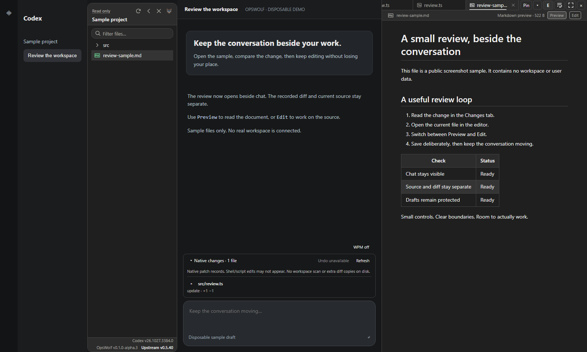
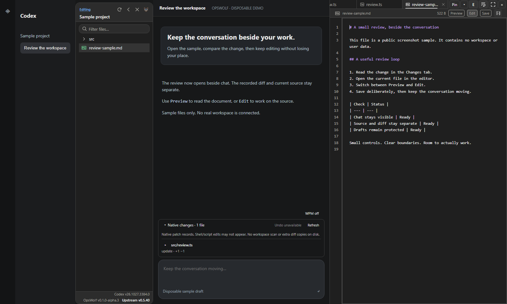
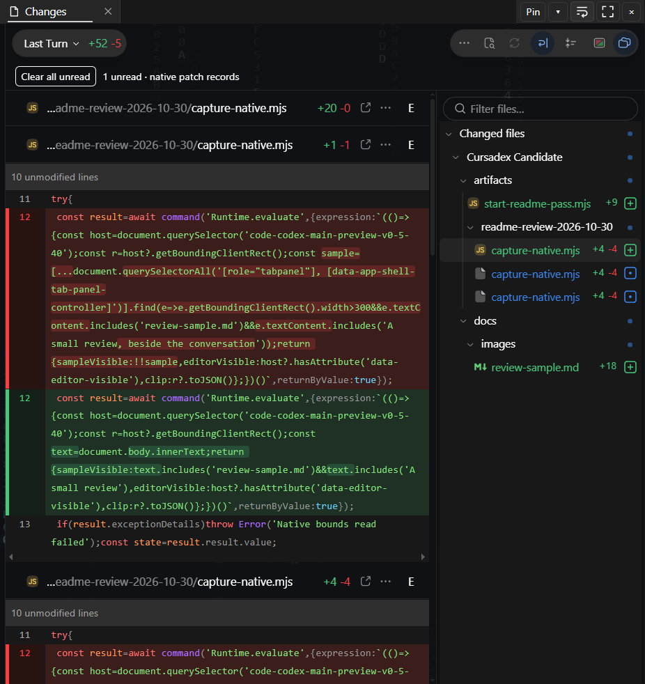
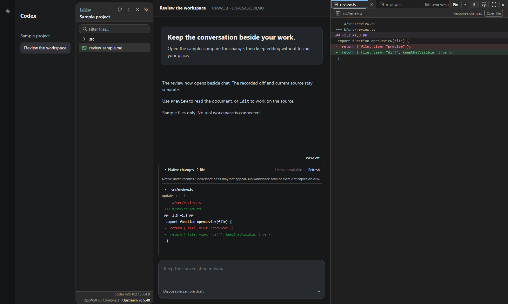
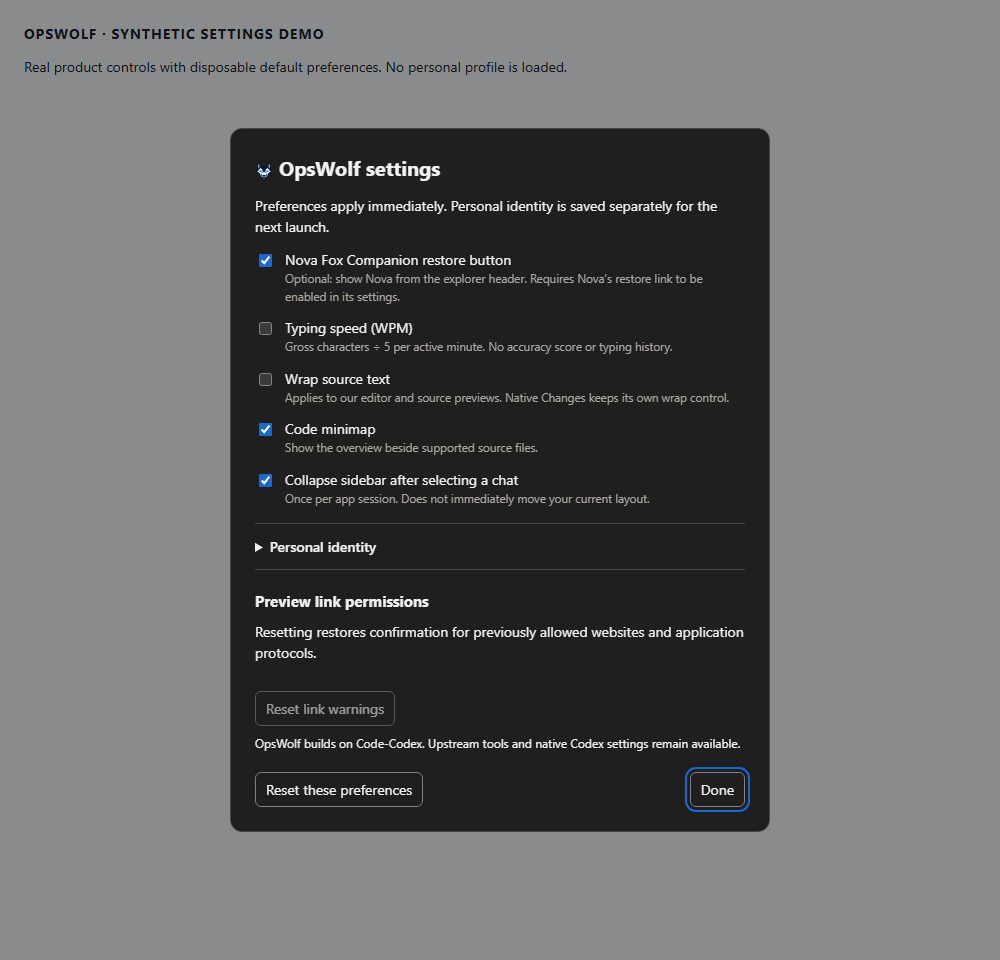

# OpsWolf

OpsWolf adds a file explorer, an editor and a place to review changes beside your Codex chat. Keep the conversation going while you read, edit and check the actual files.

Built on [Code-Codex](https://github.com/Rice-dog/code-codex), maintained independently. This is an unofficial community project, with no affiliation to OpenAI.

## From a human to a human

I wanted a file tree on the left, chat in the middle, and somewhere on the right where I could actually work on files. Then came tabs, pins, word wrap, citations and a better way to see what the agent had changed.

So yeah, that escalated pretty quickly lol.

**This is still a developer alpha. There isn't a ready-to-download OpsWolf installer yet.** If you're looking for a download button and a normal setup wizard, we're not there. You'll need Windows, the official Codex desktop app and some development tools, or an agent to walk you through the source setup below. A fresh-machine installation hasn't been verified yet.

The current source is **OpsWolf 0.1.0-alpha.15**, built on [Code-Codex v0.6.0](releases/README.md). The combined build passed its local checks, and Rain is much smoother in our hands-on testing. That is progress, not a promise that every setup works. [What we checked](docs/editor/upstream-integration.md#alpha15-qualification).

### Read it, then work on it

Open a file from the explorer and it appears beside chat. **Preview** is for reading; **Edit** lets you change supported text files. **Save**, or **Ctrl+S**, writes the file. Markdown Preview can show headings, links and tables; Edit shows the source that makes them.



*Preview: the real explorer, editor and Markdown plugin with a disposable sample file. The surrounding chat is a demo, not a native Codex conversation.*



*Edit: the same file as source text, with word wrap and line numbers. No personal files or chats are loaded in this demo.*

The **E** button opens or hides the editor. Drag its left edge to resize it, or use its fullscreen button when you want more room. Hiding a fullscreen editor resets it, so the next E puts it beside chat again.

Tabs can scroll with your mouse wheel, move by dragging, and appear in an open-files dropdown. Pin files to reopen them for that project. **Close all** leaves pins alone, and unsaved edits get a save/discard/cancel choice. Pins remember files, not unsaved drafts.

### See what changed without losing the conversation

Click Codex's live **files changed** bubble and its comparison viewer opens in the editor's **Changes** tab. You keep Codex's review controls, with the comparison beside your chat. Clicking a file in the bubble's hover list takes you to that file's change.



*The actual native Changes viewer in OpsWolf alpha.3, showing public screenshot-tool changes. Captured from the live app and cropped to the editor area so chats and the project list stay out of the image.*

There's also a persistent **Native changes** panel above the message box. It stays available after the live bubble has gone. Expand the file list, then open just the changes you want to read. **Open file** takes you from the recorded diff to the current file, where you can edit it.



*Production review controls with a sample patch and demo conversation. The panel above the message box and the recorded diff are separate from the native Changes viewer shown above.*

This uses Codex's recorded patches. It can include ordinary project files outside Git, but it won't catch every shell command or manual edit. It's a way to review work, not a backup or a complete activity log.

### The other little things that help

- **Point at the actual lines.** Select text and right-click to cite it in chat, copy a citation, or collect several ranges. Clicking a reference opens and highlights its source. It works across supported text formats.
- **Keep your reading position.** Scroll up to read without the feed constantly pulling you away. Sending your next message resumes following the conversation.
- **Find the right file.** File links in chat open in the editor when they're inside the current project. Dragging a file from the explorer into chat supplies its full location.
- **Make it comfortable.** Settings include source wrap, a minimap, an optional typing-speed counter and first-chat sidebar collapse. Our menu/settings name and logo can use your own saved identity profile; Windows identity isn't changed by that (yet).
- **Add some atmosphere.** Optional preview plugins and backgrounds live in Preview Market. [Code Rain](https://github.com/ThornsOfire/OpsWolf-Code-Rain) adds configurable rain; [Nova Fox](https://github.com/ThornsOfire/nova-fox-companion) is a separate companion with optional OpsWolf integration.

Open **OpsWolf → OpsWolf settings…** for our preferences. Open **OpsWolf → Preview Market** to add or enable preview plugins and backgrounds. With Rain active, the background-settings button at the top of the explorer opens its controls directly. If you've chosen your own app label, look under that menu name instead.



*The production settings panel with disposable default preferences. This is a synthetic capture; your personal profiles keep their own name and artwork. [Screenshot details](docs/images/README.md).*

### A few rough edges, because alpha means alpha

- Text reading goes up to **10 MiB**; editing currently stops at **512 KiB**. Bigger Markdown starts as plain text with an explicit full-render option. Files we can't edit show a red explanation. Mixed Windows/Unix line endings are one reason a file stays read-only.
- Citations work, but their long encoded links can still show in the message box and hover tooltip. The compact presentation is unfinished.
- Automatic expansion of the agent's activity details has a source repair, but the reported native layout still needs a live recheck. Following the latest activity and pausing to read are separate features.
- Rain's new worker rendering has stopped the frame drops in our recent hands-on testing, including heavy blending. We still need feedback from other setups. Blend playback options don't persist yet, and editor transparency isn't consistent across other themes. Current colours can be saved; another restart check for the new build is still pending.
- This is a basic source editor. Language servers, autocomplete, a debugger, a trustworthy context meter and broader editing support are future work.
- Codex updates can change the layout or integrations we depend on. **Review updates** shows upstream availability and blocks the stock Code-Codex installer from replacing OpsWolf. Windows/Store updates to Codex are **not frozen**. For an OpsWolf restart, save your work, close the app normally and reopen your OpsWolf launcher; the native in-app Restart action is held because it can lose our selected build. See [manual updates](docs/editor/manual-updates.md).

See [known issues](docs/editor/known-issues.md) and the [user guide](docs/editor/README.md) for the details. No claim that every Codex version, theme or monitor setup works perfectly.

<a id="getting-it-running"></a>

### Getting started today

There is no click-only installation path yet. Existing upstream installers and files in `releases/` aren't releases of these editor additions.

The current route is to build this fork's UI and matching native companion, close Codex after saving your work, then launch through that companion. Opening the normal Codex shortcut won't load the custom editor. The exact source commands are in the agent section below; you can give that section to your coding agent.

Your local folder can be anywhere sensible. It doesn't need our workspace layout or a particular project name. Preview plugins such as Markdown and PDF are separate packages. Enable the ones you want in Preview Market. A format having a preview doesn't mean it can be edited.

### What you actually need

You don't need my whole tool shelf to use OpsWolf. Start with the app; add tools for the jobs you actually want it to do.

- **To run a matching build:** Windows x64, the [official Codex desktop host](https://learn.chatgpt.com/docs/app), and this fork's matching built native companion and UI bundle. OpsWolf adds to the official host; it doesn't replace or redistribute it. There still isn't a published OpsWolf installer, so today's source route needs someone to build it first.
- **To build from source:** [Git for Windows](https://git-scm.com/install/windows), a supported [Node.js LTS with npm](https://nodejs.org/en/download), [Rust through rustup](https://rust-lang.org/tools/install/) with the Windows MSVC toolchain, and [Visual Studio Build Tools with Desktop development with C++](https://learn.microsoft.com/en-us/cpp/build/vscpp-step-0-installation). These are build tools, not a shopping list for someone who already has a reviewed matching build. Exact minimums and packaging-only tools are below.
- **For previews and atmosphere:** add only the Preview Market packages you want. Markdown, PDF and other previews, backgrounds such as Code Rain, and the standalone Nova Fox companion are optional. Install, load and enable are different steps; a preview package doesn't promise editing support. You don't need every plugin or our personal MCP connections.

**A build can download things.** The build script runs `npm ci`, and Cargo may fetch missing locked dependencies. Packaging scripts can fetch tools too. Have your agent explain the needed downloads and get the required authorization before running them. Don't treat a command called “build” as automatically offline.

### Optional: let an agent work with Windows

For desktop automation, this project's preferred option is the independent [TaskKit Windows Computer MCP](https://github.com/Longtran2404/taskkit-windows-computer-mcp), using its [Windows quickstart](https://github.com/Longtran2404/taskkit-windows-computer-mcp/blob/main/docs/WINDOWS10_QUICKSTART.md). It needs Python 3.11+ with Tkinter and the Windows `py` launcher. Codex CLI registration is an optional setup route, not an OpsWolf requirement. Computer Use, when available, is the fallback if TaskKit cannot do the job. Neither is needed to run the editor.

Start with only the target application allowed and explicitly authorize screenshots and control. Captures go to the connected AI service. TaskKit has its own session limits, fresh-capture and hit-target checks; physical Escape/F12 stops control. Finish with `end_control_session`. Its `type_text` accepts literal single-line text, not multiline scripts or key chords; use supported key actions separately. GPU/protected-window capture can still fail, so don't send blind clicks.

Those tool controls are separate from [Codex sandbox and approval rules](https://learn.chatgpt.com/docs/agent-approvals-security). MCP/app calls may need another approval; [automatic review](https://learn.chatgpt.com/docs/sandboxing/auto-review) can reject requests outside the authorized scope or involving unsafe data transfer. Changing TaskKit's input mode doesn't grant Codex permission. Computer Use also has its own app approvals. Keep permissions narrow; don't disable protections to get past a refusal. See the [official MCP setup guide](https://learn.chatgpt.com/docs/extend/mcp) if you choose to connect a server.

<a id="credit-and-contributing"></a>

### Credit, bugs and helping out

Big credit to [Rice-dog and the Code-Codex contributors](https://github.com/Rice-dog/code-codex). They built the launcher, workspace bridge, explorer and plugin foundation that made this possible.

If something breaks in our additions, report it to this fork with your versions, what you clicked, what happened and what you expected. A small sample helps a ton. Keep private documents, keys and chats out of public reports.

[Changelog](CHANGELOG.md) · [Contributing](CONTRIBUTING.md) · [MIT license](LICENSE) · [Third-party notices](THIRD_PARTY_NOTICES_EN.md)

## For agents, from an agent

<details>
<summary>Source, setup, interfaces and validation</summary>

### Identity and scope

| Item | Contract |
| --- | --- |
| Implementation | `candidate/planned-development`; [source branch](https://github.com/ThornsOfire/OpsWolf/tree/candidate/planned-development). `main` is a documentation landing page; `feature/right-editor-pane` is the historical baseline. |
| Versions | See [fork metadata](cursadex-version.json) for the display version and [Cargo.toml](Cargo.toml) for the inherited package version. This integration targets upstream Code-Codex v0.6.0. [Rain has its own plugin version](releases/plugins/appearance/code-rain/manifest.json). The source revision, package version, local handoff and running build each have their own identity. |
| Qualification | Alpha.15: 60 combined local gates passed; native tests 499 passed / 24 inherited ignores / 0 failed; all 29 locked plugins imported offline. Owner reports smooth Rain and working controls, including heavy blending. Exact post-handoff running identity and another saved-settings restart check remain unverified. [Evidence scope](docs/editor/upstream-integration.md#alpha15-qualification); no fresh-machine or universal host certification. |
| Legacy naming | Formerly Cursadex. Preserve `cursadex-*` metadata, event/storage keys, CSS hooks and technical launch names. Branding changes do not authorize migrations or identifier refactors. |
| Portability | No maintainer Desktop layout, app-state paths, personal identity artwork or external workspace scripts required by a clone. No public installer/fresh-machine certification yet. |

### Build and launch

These setup requirements come from the source manifests, scripts and upstream guidance. Local build checks and bounded owner observations are recorded separately; a fresh-machine install and broader native-host acceptance remain unverified.

| Use | Dependencies / source of truth |
| --- | --- |
| Run | Windows x64 (inherited launcher baseline Windows 10 build 19041+), separately installed official Codex host, matching built companion/UI. Build tools and MCP servers are not general runtime requirements. |
| Build UI | Git and a supported Node LTS with npm satisfying [`engines.node >=20.19`](packages/explorer-ui/package.json). The minimum is not a recommendation to install EOL Node 20; check the [official release status](https://nodejs.org/en/about/previous-releases). |
| Build native | Upstream documents Windows 11 x64 for source builds. Use the Windows MSVC Rust toolchain and Visual Studio Desktop C++ Build Tools/Windows SDK. [`Cargo.toml`](Cargo.toml) declares Rust 1.85 minimum; resolve the locked dependencies with a compatible installed stable toolchain. |
| Package MSI only | [WiX](https://docs.firegiant.com/wix/using-wix/) and [.NET SDK](https://dotnet.microsoft.com/en-us/download) for the documented .NET-tool route; a separately supplied WiX distribution still needs its own prerequisites checked. [`build-msi.ps1`](scripts/build-msi.ps1) pins WiX 5.0.2 and restores it with `dotnet tool install` only if `-WixPath` is omitted and its cached tool is missing. MSI's three-number version rule is separate from the alpha display version. Neither tool is needed for ordinary editor use or the UI/native build. |
| Selected browser fixtures only | Installed Chrome at the path used by [`browser-fixture.mjs`](scripts/browser-fixture.mjs). Chrome is not an additional normal OpsWolf runtime requirement. |
| Optional desktop automation | TaskKit prerequisites and MCP registration follow its linked quickstart; Python is not required by OpsWolf itself. The reviewed local TaskKit release source is 0.5.1, also reported by a prior `bridge_status` observation with its session stopped. Exact source-to-running-server hash identity was not established; don't infer it from the version label. |
| Optional features | Preview/background packages follow the pinned catalog/cache and explicit Preview Market actions. Nova Fox has its own standalone prerequisites; neither Nova nor a personal MCP stack is required by OpsWolf. |

TaskKit's capture/session guards do not replace client sandbox, approval, auto-review or screenshot/data-transfer authorization. After cancellation, only a new owner-authorized task may start a new control session; read-only captures do not rearm input. Reinspect and capture the current target before further input, and never replay a cancelled action. Leave configuration and installation to an explicitly authorized setup task. The linked external guides can change after the check date.

Install/download prerequisites only with environment authorization. [`build.ps1`](scripts/build.ps1) calls `npm ci` and `cargo build --workspace --locked`, **not** Cargo's `--offline` mode; inspect cache/dependency needs before execution. A reviewed runtime build and a new dependency installation are separate decisions.

```powershell
git clone --branch candidate/planned-development https://github.com/ThornsOfire/OpsWolf.git
Set-Location OpsWolf
.\scripts\build.ps1 -Configuration Release
```

`build.ps1`: installer/protocol generation and checks → `npm ci` + UI build → locked Cargo workspace build → local installer payload assembly. Native outputs: `target/release/`; bundle: `packages/explorer-ui/dist/explorer.js`. Upstream packaging assets are not published OpsWolf installers.

After saving work, completing active agents and closing Codex normally:

```powershell
$uiBundle = (Resolve-Path .\packages\explorer-ui\dist\explorer.js).Path
.\target\release\code-codex-launcher.exe run --ui-bundle $uiBundle
```

Pair UI/backend versions. This command uses mutable build outputs, not an immutable reviewed deployment. Do not kill the live host, relocate profiles or register hooks as a setup side effect.

### Runtime contracts

- Modules: UI `packages/explorer-ui/src/`; native workspace/transport/context under `crates/`. [Architecture](docs/architecture.md), [editor ownership/data flow](docs/editor/architecture.md), [development/check matrix](docs/editor/development.md).
- File I/O: authenticated workspace bridge, current-project path/type/sensitive-file policy, complete content, loaded-version conflict checks. Inline/edit limit 512 KiB; complete read limit 10 MiB; larger text virtualized; large Markdown rendering explicit. Preserve dirty drafts/caret through view changes and save failure/cancel.
- Tabs: 64 open, 32 project pins; pins store normalized-root-relative paths/order, never draft contents. Recorded diffs read-only; **Open file** resolves current source through normal reader policy.
- Review: native patch history, not filesystem snapshots; no permanent duplicate diff archive. Native comparison remains owned by Codex, positioned through qualified adapters without cloning/reparenting React nodes. Unknown layouts retain native behavior; English/observed-layout limits apply.
- Citations: supported text, up to 32 grouped ranges, bounded quotes and explicit draft markers. [Routing/presentation limits](docs/editor/citations.md). No compact composer chips claimed.
- Preferences/identity local to renderer storage. [Settings](docs/editor/settings.md), [identity/restart scope](docs/editor/identity.md), [link permissions/reset](docs/editor/links.md). No Windows/Discord identity claim; profiles, chat/auth and documents remain separate.
- Rain: [integration/pins/provenance](docs/editor/code-rain-integration.md). Verified package cache/import; host controls enablement/settings/appearance lease, independent renderer controls work budgets. Guard uninspectable host exports, qualify unique same-origin capabilities, invoke RPC methods intrinsically. Missing capabilities fail explicitly; selected/off remains disableable. Blend-option persistence remains unimplemented. F32 adds native enforcement against upstream setup plus footer review; no host/Store freeze or automatic fork feed is claimed.
- Project relinking: [metadata refresh](docs/editor/workspace-root-refresh.md); follows reported chat cwd, defers dirty drafts, explicit workspace override wins. Does not rename folders or refactor absolute source paths.

<a id="checking-a-change"></a>

### Validation and handoff

```powershell
node scripts/check-version.mjs
npm --prefix packages/explorer-ui run typecheck
npm --prefix packages/explorer-ui run build
node scripts/check-architecture.mjs
node scripts/check-changelog.mjs
```

Use installed locked dependencies; fresh dependency setup is `npm --prefix packages/explorer-ui ci`. Choose behavior checks from [development](docs/editor/development.md). Editor/review boundaries: `test-editor-pane`, `test-change-review`, `test-native-diff-host`, `test-diff-source` (`node scripts/<name>.mjs`). Appearance repair: `test-appearance-adapter`, `test-rain-host-recovery`, `test-code-rain-runtime`. Browser fixtures use installed Chrome, disposable profiles and synthetic data; fixture passes are not native certification. Historical counts are evidence for their exact source, not checks rerun by a docs edit.

Native boundaries: `cargo test -p workspace-service --locked -- --test-threads=1`; repeat for `cdp-client` / `context-resolver` when relevant. [Versioning](docs/editor/versioning.md), [tracker removal audit](docs/editor/tracker-cleanup.md).

Follow [AGENTS.md](AGENTS.md) / [CONTRIBUTING.md](CONTRIBUTING.md). Scoped change → relevant checks → exact commit/snapshot → immutable SHA-256/size inventory + runtime/dependency evidence → coordinator review → owner activation → live acceptance/rollback. Never rewrite a sealed/running build. Keep profiles, keys, chats, client data and probes out of commits. Documentation editing does not authorize downloads, activation, publication or upstream-update changes.

See the [upstream v0.6.0 release notes](releases/README.md) for the upstream changes and their verification scope. The archived [Chinese README](README.zh-CN.md) and [English translation](README.upstream.en.md) document earlier upstream behavior. Preserve upstream copyright and third-party licenses.

</details>
